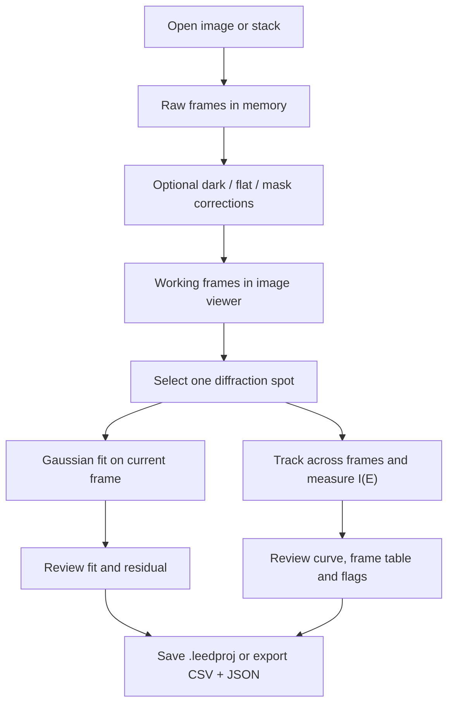

# LEED Studio — developer and future-maintainer guide

**Target:** `main` at `cde29ea` (26 October 2026 audit). See [PROJECT_STATUS.md](PROJECT_STATUS.md) for the verified state and [ROADMAP.md](ROADMAP.md) for unfinished work.

## 1. Mental model: what happens when someone uses LEED Studio?



The **image viewer** manages interaction. The **analysis functions** operate on NumPy arrays. The **project module** serializes work for later use. The *source* implements these steps; they still need end-to-end testing on a real Windows desktop and experimental benchmark data.

## 2. Important source files

| File | What it does | Why a future maintainer should open it |
|---|---|---|
| `leed_studio/app.py` | PySide6 main window, image viewer, dock panels, menus, dialogs, controls, visualization, session-state invalidation | Most GUI and workflow behavior; `MainWindow` |
| `leed_studio/analysis.py` | Read images, apply corrections, Gaussian fit, track a spot, compute intensities, export CSV | Core scientific methods and their limits |
| `leed_studio/project_io.py` | Save/load `.leedproj` ZIP archives, data/schema validation and atomic replacement on save | Reproducibility and security of project files |
| `leed_studio/__main__.py` | CLI launch, `--self-test-core`, `--self-test-gui` | Application start and automated smoke tests |
| `leed_studio/data/sample_drifting_stack.tif` | Packaged *simulated* example stack | Demo and smoke tests, not experimental validation |
| `tests/test_analysis.py` | Numerical, masking, calibration, adverse-input and tracking fixtures | What assumptions are regression-tested |
| `tests/test_project_io.py` | Project round-trip and unsafe/invalid archive checks | Project compatibility expectations |
| `tests/test_gui_smoke.py` | Optional offscreen Qt viewer/stack/spot workflow | Test requires PySide6 and pyqtgraph |
| `tests/test_release_packaging.py` | Asserts packaging files, version strings and expected CI step text | **At least two assertions conflict with today's shorter checked-in Windows workflow**; it does not execute the installer |
| `tests/test_benchmark_harness.py` | Synthetic fixture for coordinate-comparison harness | Does not replace experiment-level benchmark |
| `tools/benchmark_tuwien_fe2o3.py` | Compare one tracked beam with external x/y reference arrays, report errors | Next scientific-validation step |
| `pyproject.toml` | Version 0.11.1, dependency requirements, CLI entry point | Installation and versioning source of truth |
| `.github/workflows/windows-build.yml` | **Current minimal CI**: Windows environment, dependency install, PyInstaller, artifact upload | Do not infer tests or installer checks from older docs |
| `LEED_Studio.spec`, `build_windows.bat`, `packaging/LEED-Studio.iss` | Portable build recipe, local richer build script, installer *recipe* | Scripts are different from a verified release |

## 3. Scientific methods: what the code actually computes

### File loading and data shape

`load_image_stack` returns `frames × height × width` numerical arrays. TIFF (including multipage stacks) is the main format; Pillow handles ordinary single images. Ambiguous channel/axis layouts are rejected in some cases. The app keeps raw and working stacks in memory; do not assume lazy loading or arbitrary instrument metadata.

### Optional corrections

`correct_image_stack` supports a detector mask and dark/flat/dark-for-flat inputs. The user can choose an averaged calibration or explicit framewise interpretation. Non-positive flat denominators, mismatched arrays and nonfinite inputs are guarded against. The source does **not** claim to duplicate detector-specific or ViPErLEED polynomial calibration.

**Mask convention:** nonzero mask pixels are retained; excluded pixels become nonfinite in the working array. Check the acquisition system's convention before importing a mask. Changing calibration/settings invalidates previous measurements in the GUI.

### One-frame profile fit

`fit_spot` fits an elliptical 2D Gaussian plus background to a region near the clicked spot using SciPy numerical optimization. It returns centre/width/amplitude and diagnostics including residuals, goodness-of-fit checks, validity flags and model-based centre errors. It attempts to reject blank/noise-only regions. **Optimizer convergence is not proof of physically valid diffraction intensity.**

### One-spot I(E) measurement

`track_spot_series` starts at the chosen frame and goes forward and backward. It seeks a plausible nearby local maximum, refines its position with a centroid and rejects jumps beyond a chosen motion gate. It estimates background from the **median of an annulus** and subtracts it from a **hard circular aperture sum**. The result for each frame contains centre, energy, intensity, SNR-like diagnostic and a quality/failure label. Some failed frames can recover without automatically terminating the whole series.

This is *not* automatic beam identification, beam indexing, equivalent-beam averaging, overlap deconvolution or ViPErLEED-equivalent intensity extraction. In the GUI, frame energies are calculated as `start + index × constant step`; the user must check and confirm the axis.

### Projects, exports, and provenance

`save_project` writes a `.leedproj` ZIP containing `manifest.json` and `arrays.npz`, with format name `leed-studio-project` and schema version `1`. It stores raw/working image arrays, optional calibration arrays, optional fit residual, and JSON metadata (settings and results). Saving uses a temporary file beside the target and `os.replace` after ZIP verification. Loading rejects unexpected archive members and many invalid types/shapes.

The GUI has **Save project** and **Open project** dialogs. Fit/series CSV files may have a sibling `.csv.metadata.json` sidecar recording analysis settings. A project file should complement, not replace, the original experiment log.

There is currently no documented project schema migration, history/undo, autosave or crash-recovery workflow.

## 4. Launch, test, and reproduce

Use Python 3.11 or 3.12 for the Windows source workflow. From a fresh checkout, in a disposable Python virtual environment:

```powershell
python -m pip install -e ".[dev]"
python -m compileall -q leed_studio tests tools
python -m pytest -q -ra
python -m leed_studio --self-test-core
python -m leed_studio
```

For a non-interactive Qt test on an appropriately configured desktop/CI environment:

```powershell
$env:QT_QPA_PLATFORM = "offscreen"
python -m leed_studio --self-test-gui
```

On Windows, `install_windows.ps1` creates `.venv` and launches the source app; `run_windows.bat` launches it later. `build_windows.bat` attempts a richer sequence including tests and frozen-app checks before producing `dist\LEED Studio\LEED Studio.exe`. Inno Setup 6 and `iscc packaging\LEED-Studio.iss` are separately required for the installer recipe.

**Important:** the checked-in GitHub Actions workflow is *smaller* than the local batch script. In addition, `tests/test_release_packaging.py` currently expects installer and frozen-test steps that no longer exist in the workflow; the old 47-pass test count must not be reused for this uploaded `main` without rerunning and reconciling the tests. Its success currently establishes an executable build and artifact upload only. See [PROJECT_STATUS.md](PROJECT_STATUS.md) before making claims about tests or installer readiness.

### Suggested full acceptance record

Keep a date, OS, Python version, dependency versions, commit, commands, exits, logs, artifacts and screenshots of any GUI defects. On Windows, manually verify: application launch, sample and real image opening, fit, I(E), project save/open, CSV export/metadata, calibration/masks, failed/flagged frames, dock layout, file dialogs, scaling, installer *if built*. The checklist is in [WINDOWS_MANUAL_ACCEPTANCE_CHECKLIST.md](WINDOWS_MANUAL_ACCEPTANCE_CHECKLIST.md).

## 5. Design decisions worth preserving

1. **Standalone local desktop app:** PySide6 and pyqtgraph rather than a browser service.
2. **Gwyddion-style workspace:** the dockable layout is user-experience inspiration, **not a Gwyddion fork**.
3. **ViPErLEED is a scientific comparator:** compare methods/results; do not assert equivalence without experimental validation.
4. **Single manually selected spot first:** a narrow, inspectable workflow before multi-beam automation.
5. **Explicit energy confirmation:** avoid quietly labeling frames with invented physical energies.
6. **Prefer flagged failure to silently wrong output:** motion gates, fit validity and invalid intensity states try to make uncertainty visible.
7. **Preserve raw data and settings:** save raw and working frames plus configurable parameters.
8. **Synthetic checks before scientific claims:** unit/self-tests protect code behavior, while real benchmark data must establish scientific reliability.
9. **AI-assisted provenance:** see [CREDITS.md](CREDITS.md) for maintainer direction and development disclosure.

## 6. Current branch and documentation rules

`main` contains source version 0.11.1. [PR #1](https://github.com/karol-cieslik/leed-studio/pull/1) adds an automatic first-run simulated example and a `BEGINNER_WALKTHROUGH.md`. Until merged, it is not a `main` feature.

Treat historical release/audit files as **snapshots from their named versions**, not live status dashboards. After a new feature or release, update the README, [PROJECT_STATUS.md](PROJECT_STATUS.md), [ROADMAP.md](ROADMAP.md), user manual, and changelog with explicit evidence. Distinguish code existence, passing tests, successful Windows packaging, successful interactive Windows acceptance, and agreement with real experimental data.

If returning to the project after months, read **README → PROJECT_STATUS → ROADMAP → this guide → relevant source/test**. See [documentation index](DOCUMENTATION_INDEX.md) for the rest.
